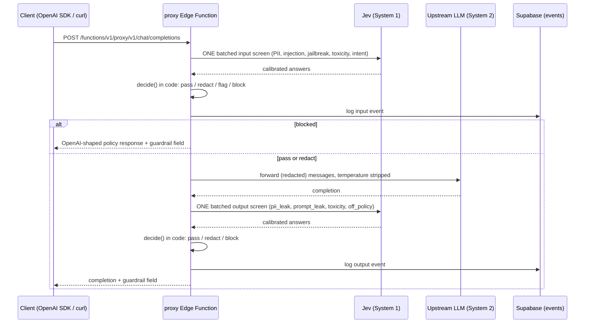

# Guardrail Proxy

A drop-in, OpenAI-compatible API proxy with a review dashboard. Every user prompt and every model response is screened by **Jev**, TypeSafe AI's fast calibrated decision model ("System 1"), in **one batched request per message**. Thresholds applied in code decide whether each message should **pass**, be **redacted and passed**, be **flagged for human review**, or be **blocked**. The upstream LLM ("System 2") is only ever called for traffic that passes.

Checks cover: PII, prompt injection, jailbreak attempts, toxicity, intent (including data exfiltration), output PII/credential leaks, prompt leakage, and off-policy responses.



## Why a fast calibrated screener instead of an LLM-as-judge?

- **Latency.** Jev is a small classification model: the screening adds tens of milliseconds per request. An LLM judge needs a full generation (often 1–3+ seconds) before it emits a verdict, and that latency lands on *every single request*, doubling the perceived speed of your app.
- **Cost.** Jev charges only for input tokens (`$0.042 / M`) and output is free. An LLM judge charges for the prompt *and* ~150 generated tokens per check across four-plus questions — the dashboard compares the two live (defaults: $2.50/M input + $10/M output, editable constants).
- **Thresholds in code.** Jev returns *calibrated probabilities*, not prose. Policy lives in a pure function (`decide()`) with sliders and presets — you can tighten "block injection above 0.8" without prompt surgery, and replay any stored event through new thresholds without re-screening.
- **Fail closed.** If the screener is unreachable after retries, the proxy flags for human review instead of silently passing. An LLM judge fails in exactly the wrong direction: unavailable judge = unguarded traffic, unless you build the same fail-closed path on top.

## Usage

### curl

```bash
curl https://<project-ref>.supabase.co/functions/v1/proxy/v1/chat/completions \
  -H "Authorization: Bearer gp_<your key>" \
  -H "Content-Type: application/json" \
  -d '{
    "model": "gpt-4o-mini",
    "messages": [{"role": "user", "content": "Hello!"}]
  }'
```

The response is standard `chat.completion` JSON plus a `guardrail` field:

```json
{
  "choices": [{ "message": { "role": "assistant", "content": "..." } }],
  "guardrail": {
    "input_decision": "pass",
    "output_decision": "pass",
    "fired_rules": [],
    "latency_ms": 84
  }
}
```

### OpenAI SDK

```ts
import OpenAI from "openai";

const client = new OpenAI({
  baseURL: "https://<project-ref>.supabase.co/functions/v1/proxy",
  apiKey: "gp_<your key>", // NOT your OpenAI key
});

const res = await client.chat.completions.create({
  model: "gpt-4o-mini",
  messages: [{ role: "user", content: "Hello!" }],
});
console.log(res.choices[0].message.content);
```

Blocked responses keep the OpenAI shape — the assistant content is a policy message and `guardrail.fired_rules` explains why, so existing clients never break.

## Setup

1. Create a Supabase project (this repo ships with the schema applied).
2. Set the secrets:

   ```bash
   supabase secrets set TYPESAFE_API_KEY=... OPENAI_API_KEY=...
   ```

   Without `OPENAI_API_KEY`, or for keys created in **Mock upstream** mode, the proxy returns canned replies (some deliberately leak a fake API key so output screening can be demoed). Jev still runs live in mock mode.

3. Deploy the three edge functions (`proxy`, `screen`, `admin`).
4. `npm install && npm run dev` for the dashboard.

## Env vars

| Variable | Where | Purpose |
| --- | --- | --- |
| `VITE_SUPABASE_URL` | frontend | Supabase project URL |
| `VITE_SUPABASE_ANON_KEY` | frontend | Supabase anon key |
| `TYPESAFE_API_KEY` | edge function secret | Jev API key |
| `OPENAI_API_KEY` | edge function secret | Upstream LLM key (never sent to the browser) |
| `OPENAI_BASE_URL` | edge function secret | Defaults to `https://api.openai.com/v1` |
| `OPENAI_MODEL` | edge function secret | Defaults to `gpt-4o-mini` |
| `DAILY_CALL_LIMIT` | edge function secret | Daily demo cap, defaults to 200 |

Example frontend env (`.env.example`):

```
VITE_SUPABASE_URL=...
VITE_SUPABASE_ANON_KEY=...
```

## Screenshots


## Threat model and limits

- **This is a demo.** Single shared workspace, no auth, permissive anon RLS on the dashboard tables. Do not point production traffic at it.
- **Regex redaction is best-effort.** It catches emails, phone numbers, SSNs, Luhn-valid card numbers, and common API-key shapes (`sk-…`, `ghp_…`, `AKIA…`). It will miss PII in unusual formats, other locales, or obfuscated text. Jev decides *whether* PII is present; the regexes decide *where* — both are fallible.
- **Daily caps.** 200 screening calls per day across `proxy` and `screen` (overridable via `DAILY_CALL_LIMIT`), 50 requests per proxy key per day. At the cap the dashboard shows a banner and the Playground switches to Replay demo mode over stored events.
- **Screening coverage.** Jev sees the last user message plus the system prompt — not full conversation history — and the regexes only scan the texts passed to them.
- **Key handling.** Only SHA-256 hashes of `gp_` keys are stored; plaintext is shown once at creation. `key_hash` is never readable by the browser client.

## Design decisions

- **One batched Jev call per stage**, not one call per question. Five input questions and four output questions ride in a single request; two round trips per proxied message total.
- **Decisions in code, not in the model.** All thresholds (block/review bands, exfiltration confidence, redact threshold) are plain numbers in a pure function, persisted as JSON in the `policies` table. Replay re-runs `decide()` on stored answers with new thresholds — zero Jev cost.
- **Precedence: block > flag > redact > pass.** Deterministic, documented, unit-testable.
- **Fail closed** on screener outage: flag for human review, never pass unguarded.
- **Mock upstream by default** so the whole pipeline (including output-leak blocking) is demoable without an OpenAI key; Jev still runs live.
- **Permissive RLS for the demo** with one hard exception: `proxy_keys.key_hash` is revoked from all client roles.
